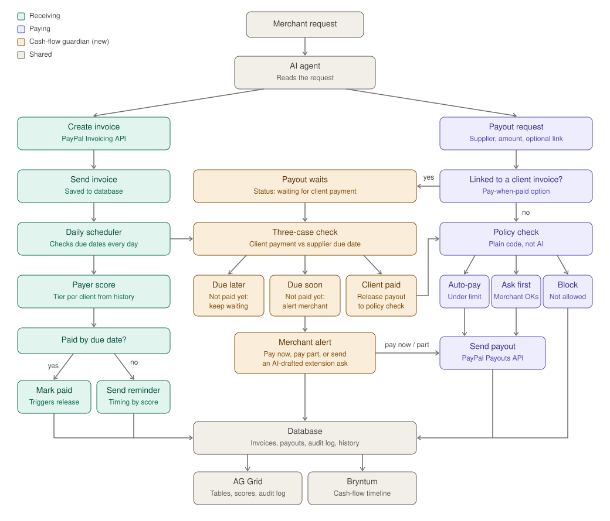

# InOut Pilot

**A cash-flow guardian for small merchants, built on PayPal and AI.**
Money in releases money out: the app collects from clients, and pays suppliers only after the linked client has paid, inside rules the merchant controls.

> Built for the *Build What's Next with PayPal and AI* hackathon. Started Oct 17, 2026. PayPal **sandbox only**.
> Demo video: **TODO: add YouTube link**



## The problem
Small merchants owe suppliers on a schedule while their own clients pay late, and nothing watches the gap. Paying out money you have not received puts the merchant out of pocket. Agents that move money also need hard limits, not just good intentions.

## What it does
- **Plain-language control.** Type "Invoice Gamma Co for $60, due in 7 days" or "Pay $20 to Singha Supplies once Gamma Co pays". An LLM only picks the action and extracts fields; code validates everything and executes.
- **Invoices and reminders.** Creates and sends PayPal invoices. A daily scheduler sends reminders, earlier and firmer for clients with a poor payer score. Reminder wording is AI-written, then checked by code (must state the real amount; no links, fees, penalties or threats) with a fixed-template fallback.
- **Pay-when-paid.** A supplier payout can be linked to a client invoice. It waits in `WAITING_FOR_CLIENT` and is released by the PayPal `INVOICING.INVOICE.PAID` webhook, then goes through the policy check again.
- **Three-case alert.** If the client has not paid and the supplier is due soon, the merchant is alerted and can pay now, pay part, or send an AI-drafted extension request (it never names the late client).
- **Auto / Ask / Block policy (plain code, not AI).** Trusted supplier under the limit: auto-pay. New supplier or over the limit: ask the merchant. Unknown supplier, hard limit or daily cap exceeded: block. Every decision is logged with a reason.
- **Payer score.** Rule-based and explainable (on-time rate, average days late, overdue invoices, reminders needed). Tiers: New, Reliable, Watch, Risky.
- **Status questions.** "Who owes me money?" is answered from the database by code, not by the model.

## Views
| View | Tool | Purpose |
|---|---|---|
| Dashboard | AG Grid | Attention queue (approve, reject, pay now, pay part, extension draft), invoices, payouts, payer scores, audit log |
| Timeline | Bryntum Scheduler Pro | Client invoices and supplier payouts linked by dependencies. Drag an invoice date and the dependent payouts move; conflicts with supplier due dates are flagged |
| Gantt | Bryntum Gantt | Who pays whom, and when, per payer and supplier |
| Calendar | Bryntum Calendar | Pay-ins and payouts as separate calendars, filter by payer |
| Taskboard | Bryntum TaskBoard | Payouts by stage; guarded drags (approve, reject, pay now) |

## Tools used
- **PayPal (sandbox):** Invoicing v2 (create, send, remind, get), Payouts v1, Webhooks (signature verification, invoice and payout events), OAuth2. Every money movement goes through these APIs.
- **AI:** any OpenAI-compatible LLM (default Groq `openai/gpt-oss-120b`). It extracts fields from plain-language requests, drafts reminders and drafts extension requests. It never decides whether money moves; code validates its output and falls back to fixed templates.
- **Supabase** (Postgres), **Express**, Node.js.

## Sponsor tools and what they do here

### Bryntum (Scheduler Pro, Gantt, Calendar, TaskBoard): the cash-flow layer
The product is a chain over time: a client pays, then a supplier gets paid. Bryntum is how that chain is modeled, seen and acted on.
- **Scheduler Pro (Timeline):** each client invoice and each linked supplier payout is an event, and the link is a Bryntum **dependency** (end-to-start, with the payout's lag kept). Dragging an invoice's expected payment date calls `POST /api/invoices/:id/shift`; the server recomputes the dependent payouts' planned dates, flags any that now fall after the supplier's due date, and offers the AI-drafted extension request. The database stays the source of truth, and the page reconciles with the server's answer.
- **Gantt:** one chart per payer and per supplier, with overdue invoices in red, waiting payouts in orange and the invoice-to-payout arrows.
- **Calendar:** pay-ins and payouts as two separate calendars, filterable by payer, so the merchant can see what is due when.
- **TaskBoard:** payouts by stage. Dragging a card calls the same approve, reject and pay-now endpoints as the dashboard, after a confirmation, and every other move is refused.
- **Why it makes the system reliable:** the Bryntum views only *propose* actions. Each one goes through the same server-side policy checks, conditional updates and audit log as everything else, so a drag on a chart cannot bypass a limit or pay twice.

### AG Grid: the operations control center
The dashboard is built on AG Grid so the merchant can sort, filter and act on large lists quickly.
- **Needs attention queue:** pending approvals and payouts waiting on clients, with Approve, Reject, Pay now, Pay part, Draft extension and Cancel buttons on each row.
- **Invoices, payouts, payer scores:** filterable tables with status colors and the payer tier next to each invoice.
- **Audit log:** every decision with its time and reason, so anything the agent did can be reviewed. This is what makes the automation inspectable and safe to trust.

## Run it yourself
Requirements: Node 20+, a free Supabase project, a PayPal developer account.

1. `npm install` (installs the Bryntum trial packages and AG Grid).
2. Supabase: run `db/schema.sql` in the SQL editor, then add one trusted supplier (see the comment at the bottom of the file).
3. PayPal sandbox: create **two US sandbox accounts** (a Business and a Personal), then an app linked to the Business account. India-region sandbox accounts cannot receive invoices from other India accounts, so use US accounts.
4. `cp .env.example .env` and fill it in. Generate `ADMIN_API_KEY` with the command in the file.
5. Webhook: expose the server (for example `cloudflared tunnel --url http://localhost:3001`), then in the app's Webhooks add `https://<your-tunnel>/webhooks/paypal` with the **Invoice paid** and **Payouts** events. Put the Webhook ID in `.env`.
6. `node server.js`, open `http://localhost:3001`, paste your admin key and press **Connect**.
7. Try it with the API:
   ```
   POST /agent/request   (header x-api-key)   {"message":"Create an invoice for client Acme, email <sandbox personal email>, $60 for shelves, due 2026-11-30"}
   POST /agent/request   {"message":"Pay $20 to <supplier name> once Acme pays, supplier due 2026-11-20"}
   ```
   Pay the invoice as the sandbox buyer and watch the payout release.

Tests: `node --test *.test.js` (policy, payer score, reminders, status, shift logic).

## Safety design
- The LLM extracts fields; **code validates and decides**. Limits live in `policy.js`.
- Approvals use conditional updates, so a double click or repeated webhook cannot pay twice.
- Payout batches use the payment id as `sender_batch_id`, so PayPal also de-duplicates retries.
- Admin routes require an API key; secrets stay in `.env`, which is git-ignored.

## Known limitations
- Sandbox only. Real money, KYC and live PayPal Payouts access are out of scope.
- Bryntum packages are 45-day trials (watermarked). Screenshots and the demo video show the intended behavior.
- One merchant, one admin key. No multi-tenant accounts.

## License
MIT. See `LICENSE`.